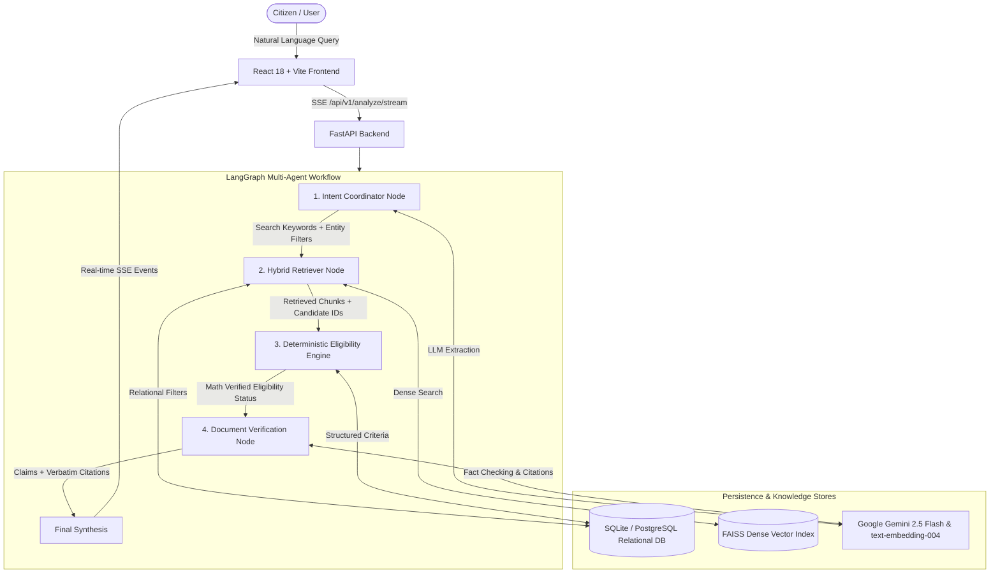
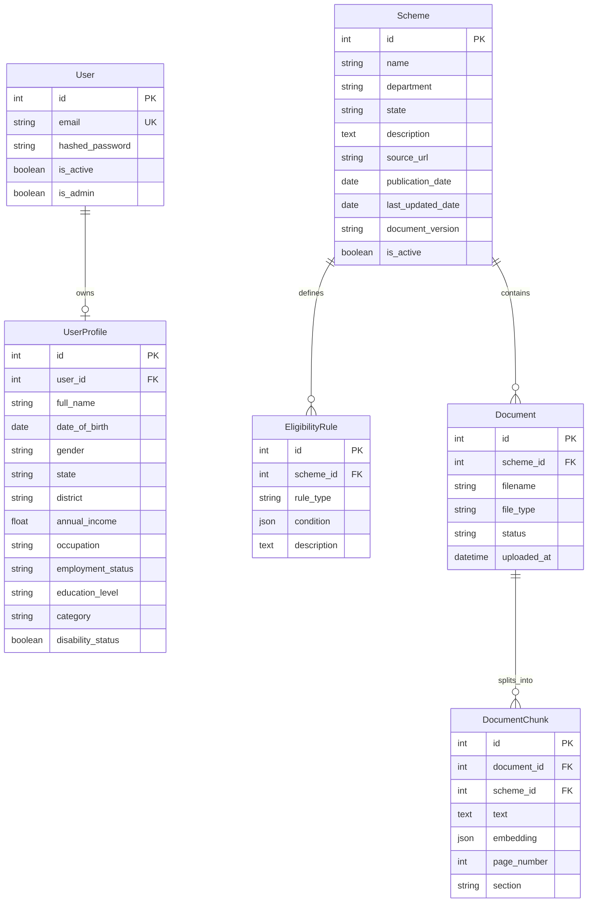

# 📋 System Requirements Specification (SRS)
## Agentic RAG Government Scheme Analyzer

---

## 1. System Overview

The **Government Scheme Analyzer** is an end-to-end multi-agent AI system designed to analyze citizen queries, match them against central and state government welfare schemes, deterministically calculate mathematical eligibility, and verify claims against official government gazettes and scheme PDFs.



---

## 2. Functional Requirements (FR)

### 2.1 FR-1: Intent Parsing & Entity Extraction
- **FR-1.1:** The system shall accept unconstrained, multi-lingual natural language queries from users (e.g., *"I'm a 21 year old OBC girl studying engineering in Telangana, family income 1.8 Lakhs"*).
- **FR-1.2:** The `coordinator_node` shall invoke Google Gemini 2.5 Flash to extract:
  - `search_keywords`: Semantic keywords optimized for vector search.
  - `state_filter`: Specific state mentioned (or `null` if central/unspecified).
  - `department_filter`: Relevant department/ministry (or `null`).
- **FR-1.3:** The system shall implement regex-based dynamic parameter extraction to parse:
  - Income values with colloquial units (`Lakh`, `Lacs`, `k`, `thousand`, `crore`).
  - Age representations (`"22 years old"`, `"age 22"`).
  - State geography, caste categories (`SC`, `ST`, `OBC`, `Minority`, `General`), gender, and employment status.
- **FR-1.4:** Extracted query attributes shall override profile attributes for the current session dynamically without mutating the user's persisted database profile.

### 2.2 FR-2: Document Ingestion & Vector Indexing
- **FR-2.1:** The system shall allow administrators to upload official scheme documents in PDF format.
- **FR-2.2:** The ingestion pipeline shall extract plain text and structural metadata (page numbers, section titles).
- **FR-2.3:** Extracted text shall be segmented into semantic chunks (maximum 500-1000 characters with 100 character overlap).
- **FR-2.4:** The system shall generate 768-dimensional dense vectors using Google's `text-embedding-004` model.
- **FR-2.5:** Vectors shall be $L_2$-normalized and stored in a FAISS `IndexFlatIP` index mapped to document chunk IDs.

### 2.3 FR-3: Hybrid Retrieval Engine
- **FR-3.1:** The system shall perform dense vector similarity search in FAISS using inner-product cosine similarity to retrieve candidate chunks.
- **FR-3.2:** The system shall enforce relational database filters on retrieved candidates, ensuring:
  - The scheme is active (`is_active == True`).
  - The scheme matches the citizen's state or is marked as `Central`.
  - The scheme matches department constraints if specified.
- **FR-3.3:** The retriever shall maintain a fallback keyword/lexical search directly in SQL if the vector store is unavailable or returns fewer than the required candidate threshold.

### 2.4 FR-4: Deterministic Eligibility Rule Engine
- **FR-4.1:** The system shall never delegate numerical inequality checks to an LLM.
- **FR-4.2:** Eligibility rules shall be modeled as structured JSON conditions:
  $$\{\text{"field"}: \text{"annual\_income"}, \text{"operator"}: \text{"<="}, \text{"value"}: 250000\}$$
- **FR-4.3:** The engine shall support operators: `==`, `!=`, `>=`, `<=`, `>`, `<`, and `IN`.
- **FR-4.4:** For each rule, the engine shall output one of:
  - `SATISFIED`
  - `NOT_SATISFIED`
  - `UNKNOWN` (missing profile data)
- **FR-4.5:** The engine shall aggregate rule verdicts into scheme-level status:
  - `LIKELY_ELIGIBLE`: All rules satisfied ($0$ not satisfied, $0$ unknown).
  - `POSSIBLY_ELIGIBLE`: Some rules satisfied, remainder unknown ($0$ not satisfied).
  - `NOT_ELIGIBLE`: At least one rule violated.
  - `INSUFFICIENT_INFORMATION`: No rules could be evaluated.

### 2.5 FR-5: Document Verification & Source Citation
- **FR-5.1:** The `verification_node` shall cross-reference the rule engine's findings against the retrieved raw PDF chunks for that scheme.
- **FR-5.2:** For each evaluated condition, the verification agent shall output:
  - `claim`: The specific rule or statement evaluated.
  - `status`: `VERIFIED`, `CONTRADICTED`, or `UNSUPPORTED`.
  - `evidence_citation`: Verbatim quote and page number from the source document.
  - `reasoning`: Concise explanation of the alignment.
- **FR-5.3:** If official document text directly contradicts a rule or if evidence is absent, the agent shall flag it explicitly.

### 2.6 FR-6: Real-Time Agentic Observability (Streaming API)
- **FR-6.1:** The backend shall expose an SSE endpoint at `GET /api/v1/analyze/stream`.
- **FR-6.2:** The API shall stream real-time events as each LangGraph node begins and completes:
  ```json
  {"type": "step", "node": "coordinator"}
  {"type": "step", "node": "retriever"}
  {"type": "step", "node": "eligibility_engine"}
  {"type": "step", "node": "verification"}
  ```
- **FR-6.3:** The final SSE payload shall deliver the complete structured result with search keywords, overrides, retrieved counts, and verified scheme cards.

### 2.7 FR-7: Citizen Profile & Authentication
- **FR-7.1:** The system shall provide JWT-based user authentication (Signup, Login, Token Refresh).
- **FR-7.2:** Users shall be able to create and update their socio-economic profile (DOB, gender, state, district, annual income, occupation, employment status, education level, social category, disability status).

### 2.8 FR-8: Admin Management Portal
- **FR-8.1:** Secure administrative access restricted to `is_admin == True` users.
- **FR-8.2:** CRUD operations for schemes (name, department, state, description, source URL, version).
- **FR-8.3:** Visual builder to define structured mathematical eligibility rules per scheme.
- **FR-8.4:** Document upload and status tracking (`UPLOADED`, `PROCESSING`, `COMPLETED`, `FAILED`).

---

## 3. Non-Functional Requirements (NFR)

| ID | Category | Requirement Description | Target Metric |
| :--- | :--- | :--- | :--- |
| **NFR-1** | **Accuracy & Hallucination Resistance** | Eligibility verdicts on modeled rules must be 100% deterministic and mathematically verified. | 0% numerical boundary hallucination. |
| **NFR-2** | **Latency (Streaming)** | Initial SSE handshake must occur within 300ms; multi-agent node progression within 1.5s - 3.5s. | $T_{first\_event} \le 300\text{ms}$, $T_{total} \le 4.0\text{s}$. |
| **NFR-3** | **Vector Retrieval Efficiency** | Sub-millisecond vector similarity search across thousands of document chunks using FAISS. | Vector search latency $\le 5\text{ms}$ per query. |
| **NFR-4** | **Auditability & Traceability** | Every eligibility claim must link to a specific document chunk, page number, and rule condition. | 100% verifiable citations for verified claims. |
| **NFR-5** | **Scalability & Modularity** | Microservices-ready modular architecture separating API, Multi-Agent Graph, RAG, and Storage. | Stateless agent workflows; horizontally scalable worker threads. |
| **NFR-6** | **Security & Data Privacy** | Citizen demographic PII (income, caste, disability) must be encrypted at rest and in transit; no PII logged in plain text. | HTTPS TLS 1.3, bcrypt password hashing (work factor 12). |
| **NFR-7** | **Graceful Degradation** | In case of external LLM API rate limits or network failures, the system must fall back to rule-only SQL checks. | 99.9% uptime for deterministic rule engine. |
| **NFR-8** | **Device & Network Accessibility** | Mobile-responsive frontend operable on low-bandwidth rural connections (3G/4G). | Initial JS bundle $< 250\text{KB}$ gzipped; responsive design (320px+). |

---

## 4. Data Models & Entity Relationships



---

## 5. Multi-Agent Workflow State Schema

The shared state passed through the LangGraph agent pipeline:

```python
class AgentState(TypedDict):
    # Input
    user_query: str
    user_profile: Optional[UserProfile]
    
    # Coordinator Node Output
    search_keywords: Optional[str]
    state_filter: Optional[str]
    department_filter: Optional[str]
    
    # Retriever Node Output
    retrieved_chunks: Optional[List[Dict[str, Any]]]
    
    # Eligibility Node Output
    eligibility_results: Optional[Dict[int, Dict[str, Any]]]
    
    # Verification Node Output
    final_response: Optional[str]
```

---

## 6. API Interface Contracts

| Endpoint | Method | Auth | Description |
| :--- | :--- | :--- | :--- |
| `/api/v1/analyze/stream?query={q}` | `GET` | Bearer Token | Streams agentic workflow steps via Server-Sent Events (SSE). |
| `/api/v1/analyze/` | `POST` | Bearer Token | Synchronous full execution of the LangGraph agent workflow. |
| `/api/v1/auth/login` | `POST` | Public | OAuth2 password flow returning JWT access token. |
| `/api/v1/auth/register` | `POST` | Public | Creates a new citizen user account. |
| `/api/v1/profile/` | `GET/PUT` | Bearer Token | Retrieves or updates current user's demographic profile. |
| `/api/v1/schemes/` | `GET` | Public | Lists active schemes with state/category filters. |
| `/api/v1/admin/schemes` | `POST` | Admin Bearer | Creates a new government scheme. |
| `/api/v1/admin/schemes/{id}/rules`| `POST` | Admin Bearer | Attaches mathematical eligibility rules to a scheme. |
| `/api/v1/admin/schemes/{id}/upload`| `POST` | Admin Bearer | Uploads and initiates PDF chunking & vectorization. |
| `/health` | `GET` | Public | Healthcheck and service readiness probe. |
